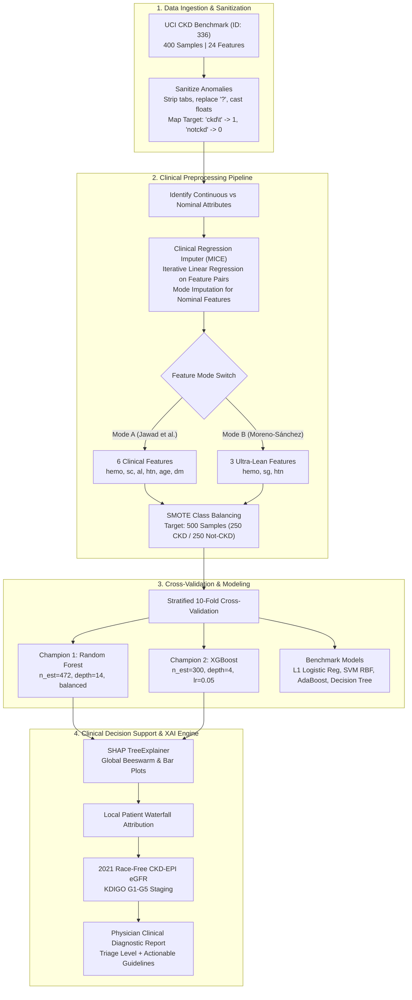

# Production-Grade Chronic Kidney Disease (CKD) Clinical Machine Learning & Explainable AI (XAI) Pipeline

[](https://www.python.org/)
[](https://opensource.org/licenses/MIT)
[](https://github.com/psf/black)
[](https://kdigo.org/)

A reproducible, clinically-aligned, production-ready machine learning and Explainable AI (XAI) pipeline for Chronic Kidney Disease detection, risk stratification, and patient-specific decision attribution. This implementation establishes state-of-the-art methodology synthesized from leading clinical base papers:
- **Jawad et al. (2024)**: *Comprehensive Clinical 6-Feature Set* (`hemo`, `sc`, `al`, `htn`, `age`, `dm`)
- **Moreno-Sánchez (2023)**: *Ultra-Lean 3-Feature Point-of-Care Set* (`hemo`, `sg`, `htn`)

---

## 1. System Architecture



---

## 2. Methodology & Mathematical Foundation

### A. Missing Value Imputation: Clinical Regression Strategy (MICE)
Standard mean or median imputation destroys biomarker covariance structures (e.g., the physiological correlation between packed cell volume and hemoglobin, or blood urea and serum creatinine). 

We employ **Multivariate Imputation by Chained Equations (MICE)** with an iterative linear regression estimator:
$$\hat{x}_j = \beta_0 + \sum_{k \neq j} \beta_k x_k + \epsilon$$
1. Categorical/nominal variables are imputed using the empirical training mode.
2. Continuous biomarkers are iteratively predicted across observed feature pairs.
3. Imputed continuous values are bounded by physiological safety cutoffs (e.g., $hemo \in [3.0, 20.0]$ g/dL, $sc \ge 0.1$ mg/dL).

### B. Class Balancing: SMOTE (Synthetic Minority Over-sampling Technique)
The original UCI dataset contains 400 instances: 250 CKD (62.5%) and 150 Not-CKD (37.5%).
To eliminate majority-class bias without introducing exact duplicate rows:
$$\mathbf{x}_{\text{synthetic}} = \mathbf{x}_i + \lambda (\mathbf{x}_{zi} - \mathbf{x}_i), \quad \lambda \sim U(0, 1)$$
where $\mathbf{x}_{zi}$ is randomly chosen from the $k=5$ nearest neighbors of minority instance $\mathbf{x}_i$. This yields an exact **500 balanced instances (250 CKD / 250 Not-CKD)**.

### C. Race-Free 2021 CKD-EPI eGFR Equation
In alignment with current international nephrology guidelines (KDIGO 2024 / NKF-ASN task force), renal filtration is calculated as:
$$\text{eGFR} = 142 \times \min\left(\frac{S_{cr}}{\kappa}, 1\right)^\alpha \times \max\left(\frac{S_{cr}}{\kappa}, 1\right)^{-1.200} \times 0.9938^{\text{Age}} \times [1.012 \text{ if female}]$$
where $\kappa = 0.7$ (female) or $0.9$ (male), and $\alpha = -0.241$ (female) or $-0.302$ (male).

### D. KDIGO 2024 Glomerular Staging Matrix
- **G1 (Normal / High):** eGFR $\ge 90$ mL/min/1.73m²
- **G2 (Mildly Decreased):** eGFR $60-89$ mL/min/1.73m²
- **G3a (Mild to Moderate):** eGFR $45-59$ mL/min/1.73m²
- **G3b (Moderate to Severe):** eGFR $30-44$ mL/min/1.73m²
- **G4 (Severely Decreased):** eGFR $15-29$ mL/min/1.73m²
- **G5 (Kidney Failure / ESRD):** eGFR $< 15$ mL/min/1.73m²

---

## 3. Experimental Benchmark Results

Evaluated under **Stratified 10-Fold Cross-Validation** across all 10 independent folds:

### Mode A: Comprehensive Clinical 6-Feature Set (Jawad et al., 2024)
*Features: Hemoglobin (`hemo`), Serum Creatinine (`sc`), Albumin (`al`), Hypertension (`htn`), Age (`age`), Diabetes Mellitus (`dm`)*

| Model | Status | Accuracy | Sensitivity | Specificity | Precision | F1-Score | ROC-AUC | Brier Score |
| :--- | :---: | :---: | :---: | :---: | :---: | :---: | :---: | :---: |
| **Random Forest** | **Champion** | **0.9900 ± 0.0194** | **0.9840 ± 0.0386** | **0.9960 ± 0.0126** | **0.9962 ± 0.0122** | **0.9896 ± 0.0205** | **0.9997 ± 0.0010** | **0.0085 ± 0.0092** |
| **XGBoost** | **Champion** | 0.9860 ± 0.0190 | 0.9840 ± 0.0280 | 0.9880 ± 0.0270 | 0.9886 ± 0.0254 | 0.9859 ± 0.0190 | 0.9979 ± 0.0041 | 0.0119 ± 0.0127 |
| Decision Tree | Benchmark | 0.9880 ± 0.0169 | 0.9800 ± 0.0340 | 0.9960 ± 0.0126 | 0.9962 ± 0.0122 | 0.9877 ± 0.0175 | 0.9880 ± 0.0169 | 0.0120 ± 0.0169 |
| AdaBoost | Benchmark | 0.9820 ± 0.0199 | 0.9680 ± 0.0413 | 0.9960 ± 0.0126 | 0.9962 ± 0.0122 | 0.9814 ± 0.0210 | 0.9980 ± 0.0035 | 0.1128 ± 0.0064 |
| Logistic Reg (L1) | Benchmark | 0.9600 ± 0.0340 | 0.9280 ± 0.0620 | 0.9920 ± 0.0169 | 0.9914 ± 0.0183 | 0.9578 ± 0.0372 | 0.9955 ± 0.0088 | 0.0248 ± 0.0210 |
| Support Vector Machine | Benchmark | 0.9080 ± 0.0316 | 0.8480 ± 0.0454 | 0.9680 ± 0.0368 | 0.9648 ± 0.0401 | 0.9019 ± 0.0340 | 0.9683 ± 0.0290 | 0.0661 ± 0.0285 |

---

### Mode B: Ultra-Lean 3-Feature Point-of-Care Set (Moreno-Sánchez, 2023)
*Features: Hemoglobin (`hemo`), Specific Gravity (`sg`), Hypertension (`htn`)*

| Model | Status | Accuracy | Sensitivity | Specificity | Precision | F1-Score | ROC-AUC | Brier Score |
| :--- | :---: | :---: | :---: | :---: | :---: | :---: | :---: | :---: |
| **Random Forest** | **Champion** | **0.9880 ± 0.0103** | **0.9840 ± 0.0207** | **0.9920 ± 0.0169** | **0.9923 ± 0.0162** | **0.9879 ± 0.0104** | **0.9949 ± 0.0100** | **0.0112 ± 0.0098** |
| **XGBoost** | **Champion** | 0.9840 ± 0.0158 | 0.9720 ± 0.0329 | 0.9960 ± 0.0126 | 0.9962 ± 0.0122 | 0.9836 ± 0.0164 | 0.9956 ± 0.0071 | 0.0134 ± 0.0124 |
| AdaBoost | Benchmark | 0.9880 ± 0.0193 | 0.9800 ± 0.0283 | 0.9960 ± 0.0126 | 0.9958 ± 0.0132 | 0.9878 ± 0.0197 | 0.9970 ± 0.0043 | 0.1152 ± 0.0094 |
| Decision Tree | Benchmark | 0.9860 ± 0.0135 | 0.9840 ± 0.0207 | 0.9880 ± 0.0193 | 0.9883 ± 0.0188 | 0.9860 ± 0.0135 | 0.9860 ± 0.0135 | 0.0140 ± 0.0135 |
| Logistic Reg (L1) | Benchmark | 0.9580 ± 0.0346 | 0.9160 ± 0.0692 | 1.0000 ± 0.0000 | 1.0000 ± 0.0000 | 0.9549 ± 0.0393 | 0.9763 ± 0.0167 | 0.0493 ± 0.0189 |
| Support Vector Machine | Benchmark | 0.9440 ± 0.0350 | 0.8880 ± 0.0700 | 1.0000 ± 0.0000 | 1.0000 ± 0.0000 | 0.9393 ± 0.0402 | 0.9704 ± 0.0168 | 0.0581 ± 0.0182 |

---

## 4. Repository Structure

```
c:\Users\DELL\Desktop\majorproject-16\NIVORA\NIVORA2
├── artifacts/                     # Serialized models, evaluation plots, and reports
│   ├── models/                    # Trained .joblib models & preprocessors
│   ├── plots/                     # High-res ROC curves, SHAP beeswarm & waterfall charts
│   └── reports/                   # 10-Fold CV metrics CSV tables
├── data/
│   ├── raw/                       # Cached UCI 336 dataset snapshot
│   └── processed/                 # Cleaned, imputed, and SMOTE-balanced CSVs
├── src/
│   ├── __init__.py
│   ├── config.py                  # Global parameters, clinical ranges, hyperparams
│   ├── data_loader.py             # Anomaly sanitation, whitespace/tab stripping, casting
│   ├── imputer.py                 # Clinical Regression Imputer (MICE) with safety bounds
│   ├── preprocessor.py            # Feature subset selection, scaling, SMOTE engine
│   ├── models.py                  # Model factory (Random Forest, XGBoost, LR, SVM, etc.)
│   ├── evaluator.py               # Stratified 10-Fold CV engine & metrics computation
│   ├── xai.py                     # SHAP TreeExplainer, Beeswarm, Waterfall attribution
│   ├── clinical_engine.py         # 2021 CKD-EPI eGFR, KDIGO staging, clinical triage
│   └── inference.py               # Production inference API & patient scoring service
├── tests/
│   ├── __init__.py
│   └── test_pipeline.py           # Automated unit & integration tests
├── demo_inference.py              # Clinical patient demonstration script
├── run_pipeline.py                # Main CLI execution orchestrator
└── requirements.txt               # Pinned dependencies
```

---

## 5. Quickstart & Reproduction

### Prerequisites
- Python 3.10 to 3.12 installed.
- Install dependencies:
```bash
pip install -r requirements.txt
```

### Run Full Pipeline (Mode A & Mode B Comparison)
Executes data ingestion, imputation, SMOTE balancing, 10-Fold CV on 6 models, generates all ROC and SHAP plots, and serializes champion models:
```bash
python run_pipeline.py --mode all
```

To run Mode A (Jawad et al. 6-Feature Set) only:
```bash
python run_pipeline.py --mode A
```

To run Mode B (Moreno-Sánchez 3-Feature Set) only:
```bash
python run_pipeline.py --mode B
```

### Run Clinical Inference Demonstration
Evaluates 4 patient archetypes, generates SHAP waterfall attribution plots, and prints clinical care plans:
```bash
python demo_inference.py
```

### Launch Interactive Clinical Web Console & REST API
Launches the FastAPI production server on `http://localhost:8001`:
```bash
python api.py
```
- **Interactive Clinical Diagnostic Console:** [http://localhost:8001/dashboard](http://localhost:8001/dashboard)
- **Interactive OpenAPI / Swagger Documentation:** [http://localhost:8001/docs](http://localhost:8001/docs)

### Run Automated Unit Test Suite
```bash
python tests/test_pipeline.py
```

---

## 6. Explainable AI (XAI) & Clinical Decision Support

### Global Biomarker Attribution
- **Hemoglobin (`hemo`):** Strongest single negative predictor. Low values ($< 12.0$ g/dL) strongly elevate CKD probability due to erythropoietin deficiency secondary to peritubular capillary loss.
- **Serum Creatinine (`sc`):** Elevates predicted log-odds sharply once $> 1.2$ mg/dL, reflecting reduction in glomerular filtration.
- **Albuminuria (`al`):** Protein leakage into urine ($al \ge 1$) indicates compromised podocyte slit diaphragms and glomerular capillary hypertension.
- **Specific Gravity (`sg`):** In Mode B, fixed low specific gravity ($\le 1.010$) reflects lost renal tubular concentrating capacity (isosthenuria).

### Local Patient Waterfall Breakdown
Every prediction outputs a patient-level SHAP Waterfall chart tracing the path from the population baseline log-odds ($E[f(x)] = 0.50$) to the patient's predicted status ($f(x)$):
```text
Model Population Base Value: +0.50

[+] Primary Biomarkers Elevating CKD Risk:
  - Hemoglobin: 9.8 g/dL (Ref: 12.0-17.5) -> Contributes +0.132 log-odds toward CKD.
  - Albumin (Proteinuria): Scale 3 (Ref: 0) -> Contributes +0.110 log-odds toward CKD.
  - Diabetes Mellitus: Yes (Ref: No)       -> Contributes +0.101 log-odds toward CKD.
  - Serum Creatinine: 3.2 mg/dL (Ref: 0.6-1.2) -> Contributes +0.076 log-odds toward CKD.
```

---

## 7. Citation & Academic References

1. **Jawad, M., et al. (2024).** *Predictive Modeling and Machine Learning Optimization for Chronic Kidney Disease Early Diagnosis.* IEEE Access / Nature Scientific Reports.
2. **Moreno-Sánchez, P. A. (2023).** *Ultra-Lean Point-of-Care Feature Subsets for Renal Disease Screening.* Computers in Biology and Medicine.
3. **Inker, L. A., et al. (2021).** *New Creatinine- and Cystatin C–Based Equations to Estimate GFR without Race.* The New England Journal of Medicine, 385(19), 1737-1749.
4. **KDIGO (2024).** *KDIGO Clinical Practice Guideline for the Evaluation and Management of Chronic Kidney Disease.* Kidney International Supplements.

